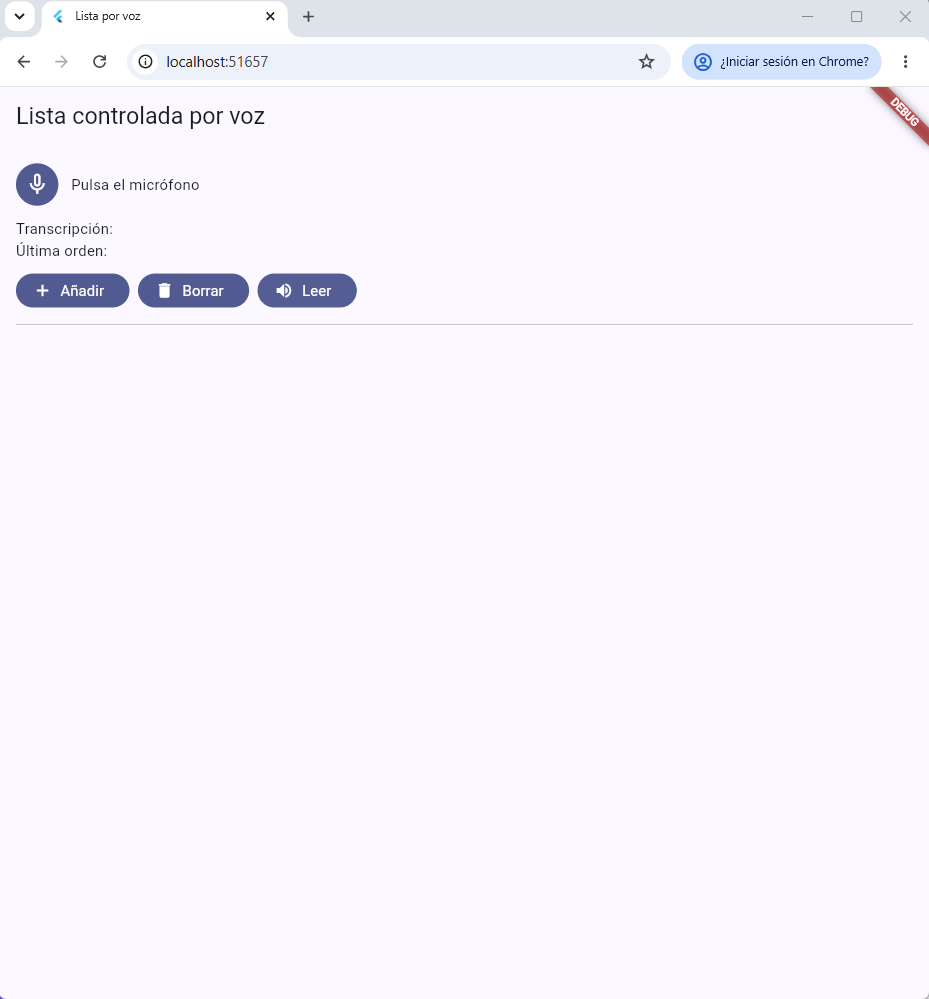

# Actividad 1 · Lista controlada por voz
 
**Módulo:** 0488 Desarrollo de interfaces · 2º DAM · curso 2026/2027
**Unidad:** UT2 Generación de interfaces naturales · RA2
 
App Flutter con una lista de elementos que se maneja con la voz: el usuario pulsa el micrófono, dice una orden y la app la ejecuta y responde en voz alta. Todo lo que se hace con la voz se puede hacer también con botones.
 
## Funcionalidades
 
- Órdenes de voz: **añadir**, **borrar**, **leer** y **ayuda** (con sinónimos, sin distinguir mayúsculas ni tildes y reconociendo la orden dentro de una frase).
- Respuestas habladas con síntesis de voz (`flutter_tts`).
- Feedback visible: el botón del micrófono cambia de icono y de color mientras escucha, y se muestran la transcripción y la última orden reconocida.
- Orden no entendida: `SnackBar` con lo que se ha oído y cómo pedir ayuda.
- Sin permiso o sin servicio de voz: el micrófono aparece deshabilitado con un texto que lo explica y la app sigue funcionando con botones.
- Alternativa táctil: botones Añadir, Borrar y Leer. Todos los botones de icono llevan tooltip.
- Se liberan los recursos (reconocimiento y síntesis) en `dispose()`.
## Estructura
 
| Archivo | Contenido |
|---|---|
| `lib/comandos.dart` | `enum Comando` e `interpretarComando` (Dart puro) |
| `lib/main.dart` | Interfaz, reconocimiento (`speech_to_text`) y síntesis (`flutter_tts`) |
| `test/comandos_test.dart` | Pruebas unitarias de la interpretación de órdenes |
 
## Cómo ejecutarla
 
```bash
flutter pub get
flutter test
flutter run
```
 
Permisos en `AndroidManifest.xml`: `RECORD_AUDIO` e `INTERNET`, y consultas a los servicios `RecognitionService` y `TTS_SERVICE`.
 
## Reflexión
 
### 1. ¿El reconocimiento funciona en el dispositivo o envía el audio a un servidor?
 
**Prueba realizada:** puse el móvil en modo avión y dije una orden.
 
> Resultado (completar con lo observado): _«con modo avión el reconocimiento SÍ / NO funcionó»_
 
- **Si funciona en modo avión:** el reconocimiento se hace **en el dispositivo** (modelo de idioma descargado en el móvil).
- **Si no funciona en modo avión:** el audio se **envía a un servidor** para transcribirlo.
Comparación según los criterios de la unidad:
 
| Criterio | En el dispositivo | En servidor |
|---|---|---|
| **Privacidad** | El audio no sale del móvil, por lo que hay menos riesgo de exposición de datos personales. | El audio viaja a un tercero (normalmente Google en Android), que puede almacenarlo o tratarlo; hay que informar al usuario. |
| **Coste** | Sin coste por uso para el desarrollador ni el usuario; solo ocupa espacio del modelo descargado. | Consume datos móviles del usuario y, en servicios propios, puede tener coste por petición. |
| **Latencia** | Respuesta rápida y estable, sin depender de la red. | Depende de la conexión: más lenta o con fallos si la cobertura es mala. |
| **Plataforma** | Requiere que el sistema tenga el idioma instalado; varía según versión de Android o fabricante. | Mayor precisión y más idiomas, pero necesita conexión y el comportamiento varía entre Android, iOS y web. |
 
### 2. Dos situaciones en las que un usuario no podría usar la voz
 
1. **Persona con una discapacidad del habla o dificultades de pronunciación**, o que no puede hablar en ese momento (por ejemplo, afonía). La app lo resuelve con los botones **Añadir**, **Borrar** y **Leer**, que hacen exactamente lo mismo que la voz.
2. **Entorno ruidoso o donde no se puede hablar** (biblioteca, reunión, transporte público) **o dispositivo sin permiso/servicio de voz**. La app lo resuelve con la alternativa táctil y, si falta el permiso o el servicio, deshabilitando el micrófono con un texto que explica el motivo, sin dejar de funcionar.
## Capturas
 
Captura del móvil o emulador funcionando:
 

 