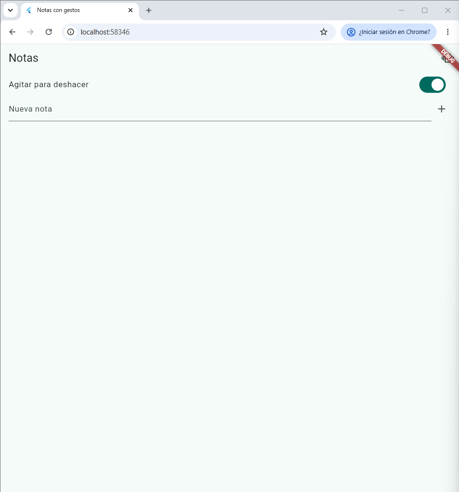

# Actividad 2 · Agitar para deshacer
 
**Módulo:** 0488 Desarrollo de interfaces · 2º DAM · curso 2026/2027
**Unidad:** UT2 Generación de interfaces naturales · RA2
 
App de notas en Flutter en la que agitar el móvil recupera la última nota borrada. El gesto es opcional y siempre tiene una alternativa táctil, como exige el criterio 2.5.4 (Activación mediante movimiento) de WCAG 2.2.
 
## Funcionalidades
 
- Lista de notas con un campo para añadirlas.
- Cada nota se borra deslizándola (`Dismissible`) o con un `IconButton` con tooltip.
- Al borrar, se guarda la nota y su posición y se muestra un `SnackBar` «Nota borrada» con la acción «Deshacer» (alternativa táctil).
- Al agitar el móvil se restaura la última nota borrada en su posición y se muestra «Nota recuperada al agitar». Si no hay nada que deshacer, la sacudida no hace nada.
- Interruptor `SwitchListTile` «Agitar para deshacer»: desactivado, la app no escucha el sensor.
- Icono en la `AppBar` que indica si el gesto está activo, con tooltip explicativo.
- Si el dispositivo no tiene acelerómetro (por ejemplo, en escritorio), se desactiva el interruptor y se muestra «Este dispositivo no tiene acelerómetro».
- La suscripción al sensor se cancela en `dispose()` y al desactivar el interruptor.
## Estructura
 
| Archivo | Contenido |
|---|---|
| `lib/detector_agitado.dart` | Clase `DetectorAgitado` (Dart puro): umbral, pausa y método `procesar` |
| `lib/main.dart` | Interfaz de notas y suscripción a `userAccelerometerEventStream` |
| `test/detector_agitado_test.dart` | Pruebas: reposo, sacudida, segunda sacudida dentro de la pausa y sacudida pasada la pausa |
 
## Cómo ejecutarla
 
```bash
flutter pub get
flutter test
flutter run
```
 
En Android no hace falta ningún permiso para el acelerómetro con la frecuencia de muestreo usada (`SensorInterval.gameInterval`).
 
## Reflexión
 
### 1. Umbrales de 10, 15 y 25 m/s² caminando con el móvil en la mano
 
> Resultados (completar con lo observado en mi móvil):
>
> | Umbral | ¿Se activó caminando? | Comentario |
> |---|---|---|
> | 10 m/s² | _sí / no_ | _…_ |
> | 15 m/s² | _sí / no_ | _…_ |
> | 25 m/s² | _sí / no_ | _…_ |
 
**Umbral elegido:** _… m/s²_
 
**Por qué:** _(explicar con lo observado: un umbral bajo provoca falsos positivos al caminar o gesticular, uno muy alto obliga a sacudir con demasiada fuerza y el gesto deja de ser cómodo; se busca el valor que detecte una sacudida intencionada sin dispararse con el movimiento normal)._
 
### 2. ¿Por qué `userAccelerometerEventStream` y no `accelerometerEventStream`?
 
`userAccelerometerEventStream` mide la aceleración **sin la gravedad**, es decir, solo el movimiento que produce el usuario. `accelerometerEventStream` incluye la gravedad.
 
Con el móvil **en reposo**, el acelerómetro con gravedad mide un módulo de aproximadamente **9,8 m/s²** (la gravedad terrestre) en lugar de 0. Con un umbral como 10 m/s², una pequeña vibración ya lo superaría, y con umbrales algo menores el detector se activaría **siempre**, sin que nadie agite el móvil. Habría que restar la gravedad manualmente, mientras que el flujo de aceleración de usuario ya lo hace.
 
### 3. Dos condiciones de WCAG 2.5.4 (Activación mediante movimiento) que cumple la app
 
1. **Alternativa sin movimiento:** la misma función (recuperar la nota borrada) se puede hacer con la interfaz táctil, con la acción «Deshacer» del `SnackBar`.
2. **Posibilidad de desactivar la respuesta al movimiento:** el interruptor «Agitar para deshacer» permite desactivar el gesto para evitar activaciones accidentales, y entonces la app deja de escuchar el sensor.
## Capturas
 
 
